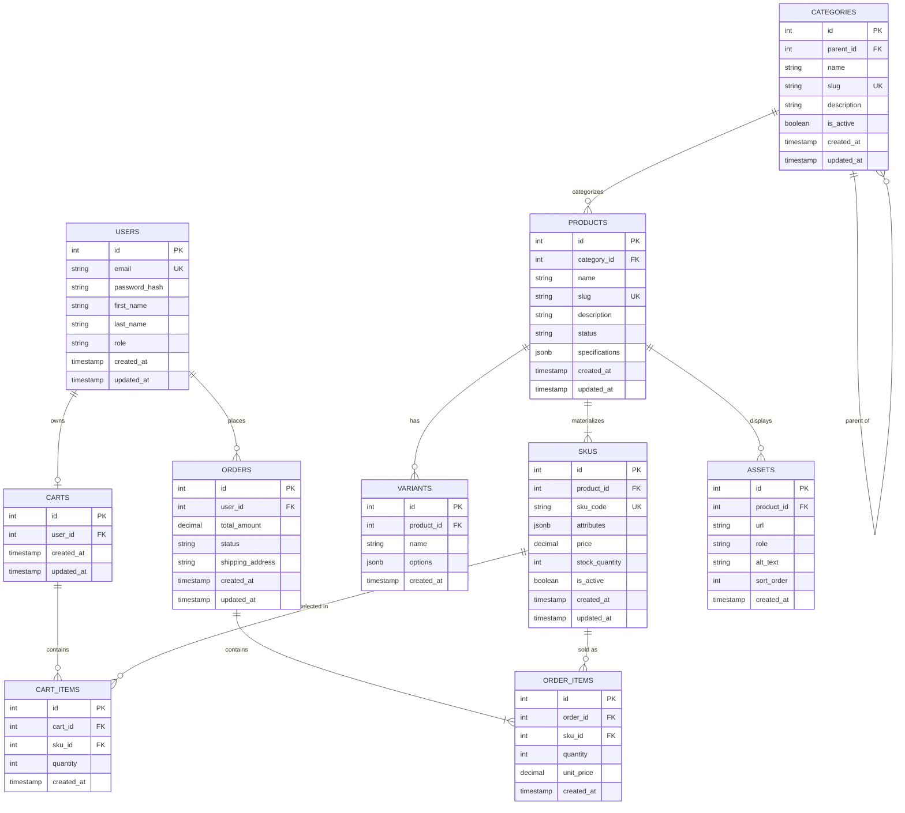

# Sprint 1 Manual: System Architecture & Scope Definition

**Course:** E-Commerce  
**Department:** Department of Computer Science / Artificial Intelligence  
**Institution:** Institute of Mathematics & Computer Science, University of Sindh, Jamshoro  
**Student Name:** Kalpna Asnani  
**Roll No:** 2k23/CSM/55  
**Project:** TerraCraft Artisanal Ceramics  
**Submission File:** `/docs/SPRINT_1.md`  
**Format:** Structured Markdown Document with Architectural Specifications & ERD  

---

## 1. Introduction

Sprint 1 initiates the architectural planning and domain modeling phase of the TerraCraft E-Commerce Software Development Life Cycle (SDLC). TerraCraft is a domain-specialized e-commerce system engineered for artisanal pottery, handcrafted tableware, and horticultural stoneware.

Prior to software implementation, this document formally specifies the target demographic, functional scope boundaries, underlying relational data structures, and technological frameworks. The objective is to establish an immutable architectural baseline upon which the catalog database foundation (Sprint 2) and full transactional workflows (Sprint 3+) are constructed.

---

## 2. Project Deliverables

This document fulfills all four required sections specified in the Sprint 1 rubric:
1. **Target Audience & Market Focus:** User persona, core pain point, and domain scope.
2. **Minimum Viable Product (MVP) Feature Scope Matrix:** Prioritized functional specifications across core user workflows.
3. **Tech Stack Selection & Justification:** Architectural rationale and trade-off analysis for selected software frameworks and database engine.
4. **Entity-Relationship Diagram (ERD):** Fully normalized relational schema with explicit primary keys, foreign keys, SQL-compliant data types, and cardinalities.

---

## 3. Specification Requirements

### Section 1: Target Audience & Market Focus

#### Primary Persona: Commercial Buyer & Design Aficionado
- **Persona Name:** Amara Vance
- **Demographic:** 32-year-old Interior Stylist & Boutique Hospitality Buyer.
- **Context:** Procures bespoke, durable ceramic dinnerware and architectural stoneware planters for high-end boutique bistros, studio apartments, and design showrooms.
- **Behavioral Attributes:** Evaluates materials with extreme scrutiny; requires verified food safety disclosures, lead-free glaze certifications, heat tolerances (microwave/dishwasher/oven safe), and dimensional precision to fit custom commercial shelving.

#### Core Pain Point
Commercial and discerning residential pottery buyers face persistent operational friction when utilizing generic retail e-commerce marketplaces:
1. **Glaze & Dimensional Misrepresentation:** Generic catalogs aggregate arbitrary variant dimensions into a Cartesian product matrix, advertising combinations (e.g., small espresso cup in high-temperature volcanic glaze) that ceramic kilns cannot physically formulate or fire safely.
2. **Phantom SKUs & Ghost Inventories:** Retail systems frequently retain out-of-stock or non-manufactured combinations with `stock = 0`, cluttering filtering systems and frustrating procurement agents.
3. **Absence of Domain-Specific Specifications:** Critical safety indicators (food safe, dishwasher safe, clay body composition) are relegated to free-form paragraphs rather than validated queryable schema attributes.

#### Domain Scope
TerraCraft serves the **Artisanal Ceramics & Handcrafted Stoneware vertical market**. The domain encompasses:
- Wheel-thrown and slip-cast tableware (dinner plates, ramen bowls, cups, pour-over drippers).
- Horticultural and botanical stoneware (succulent planters, self-watering pots, pedestal vessels).
- Sculptural home decor (ceramic vases, sculptural candelabras, incense burners).

---

### Section 2: Minimum Viable Product (MVP) Feature Scope

The TerraCraft Minimum Viable Product encompasses five core user and administrative workflows, strictly bounded to guarantee semester feasibility while enforcing institutional database engineering standards.

| Category | Feature Name | Description | Priority |
| :--- | :--- | :--- | :--- |
| **Authentication** | User Registration & Authentication | Cryptographic password hashing utilizing `bcrypt` and stateless session authorization via signed JSON Web Tokens (JWT) with strict role segregation (`admin` vs. `customer`). | **High (MVP)** |
| **Catalog** | Product List & Search | Hierarchical taxonomy browsing (multi-level category tree) with parent-child navigation, slug-based resource lookup, and status-bounded visibility (`draft`, `published`, `archived`). | **High (MVP)** |
| **Cart** | Cart Management | Session-persistent shopping cart management permitting item addition, quantity modification, and item removal tied to concrete sellable SKUs. | **High (MVP)** |
| **Checkout** | Order Processing | Transactional order object instantiation, capturing point-in-time unit prices and snapshot product metadata with simulated mock payment integration. | **High (MVP)** |
| **Admin** | Inventory Control | Protected administrative CRUD operations for category hierarchies, product drafts, variant dimensions, and sellable SKU records with non-negative stock constraints. | **Medium** |

---

### Section 3: Tech Stack Selection & Justification

The technical architecture for TerraCraft is selected based on local portability, relational data integrity, and strict adherence to university software engineering practices.

#### 1. Frontend Framework: React (with Vite)
- **Selection:** React 18+ bundled via Vite.
- **Technical Justification:** Vite provides lightning-fast cold server start times and instantaneous Hot Module Replacement (HMR) without complex bundler configuration. React’s declarative component model and unidirectional data flow cleanly isolate administrative state management (e.g., dynamic SKU combination tables and category tree rendering) from presentation, avoiding legacy DOM manipulation pitfalls.

#### 2. Backend Infrastructure: Node.js with Express
- **Selection:** Node.js (v24.x LTS) with Express.
- **Technical Justification:** Express provides an unopinionated, high-throughput asynchronous HTTP middleware framework. Its non-blocking event-driven architecture handles concurrent API requests efficiently. Leveraging native JavaScript across both client and server minimizes cognitive context switching and eliminates external runtime compilation overhead, ensuring the project remains 100% portable for USB distribution.

#### 3. Database Management System: PostgreSQL
- **Selection:** PostgreSQL (Relational DBMS) with parameterized raw SQL queries.
- **Technical Justification:** Artisanal e-commerce demands uncompromising transactional consistency (ACID guarantees). PostgreSQL enforces strict schema validation, composite unique constraints, check constraints (`CHECK (stock_quantity >= 0)`), and explicit foreign key cascading/restriction policies. Unlike non-relational document stores (MongoDB), PostgreSQL prevents orphaned records and phantom inventory states. Furthermore, PostgreSQL's native `JSONB` data type enables validated semi-structured storage for dynamic pottery specifications (clay body, glaze finish, firing cone) without sacrificing relational integrity.

#### 4. Caching & Asynchronous Processing: In-Memory Node.js Cache / pg-mem Engine
- **Selection:** In-Memory session caching and `pg-mem` execution engine.
- **Technical Justification:** For an academic local demonstration that must run directly from a USB stick without mandatory Docker or cloud dependencies, an in-memory caching and testing layer allows the automated test suite and demo server to run deterministically on any evaluation machine while maintaining standard PostgreSQL DDL and query compatibility.

---

### Section 4: Entity-Relationship Diagram (ERD)

The TerraCraft relational database schema enforces strict Boyce-Codd / Third Normal Form (3NF) normalization. The schema models accounts, recursive category trees, product masters, variant dimensions, materialized sellable SKUs, media assets, shopping carts, and immutable financial orders.

#### Relational Constraints & Cardinalities:
- `USERS` (1) to (0..N) `ORDERS`: A user may place zero or multiple orders; every order belongs to exactly one user.
- `USERS` (1) to (0..1) `CARTS`: A user owns at most one active cart.
- `CATEGORIES` (1) to (0..N) `CATEGORIES`: A category optionally references a parent category (recursive self-join for category hierarchy).
- `CATEGORIES` (1) to (0..N) `PRODUCTS`: A category contains zero or many products; each product belongs to one canonical category (`ON DELETE RESTRICT`).
- `PRODUCTS` (1) to (0..N) `VARIANTS`: A product defines zero or more variant option types (e.g., Size, Glaze).
- `PRODUCTS` (1) to (1..N) `SKUS`: A product materializes into one or more concrete sellable SKUs (`ON DELETE CASCADE`).
- `PRODUCTS` (1) to (0..N) `ASSETS`: A product may display multiple photography assets.
- `SKUS` (1) to (0..N) `CART_ITEMS`: A SKU is selected zero or many times in customer carts.
- `SKUS` (1) to (0..N) `ORDER_ITEMS`: A SKU is sold zero or many times in historical orders.
- `ORDERS` (1) to (1..N) `ORDER_ITEMS`: An order must contain at least one purchased line item (`ON DELETE CASCADE`).

---

## 4. Submission & Evaluation Alignment

- **Student:** Kalpna Asnani (Roll No: 2k23/CSM/55)
- **Repository Structure:** Formatted for direct local inspection and offline grading.
- **Evaluation Criteria Addressed:**
  - **Architecture Clarity (30%):** Validated trade-offs for React, Express, PostgreSQL, and offline execution.
  - **ERD Completeness & Validity (40%):** 3NF normalization, explicit PK/FK relationships, cardinalities, SQL types, and check constraints.
  - **Scope Feasibility (20%):** Bounded MVP workflows achievable within semester timeline.
  - **Documentation Quality (10%):** Structured GitHub Markdown adhering to university standards.
