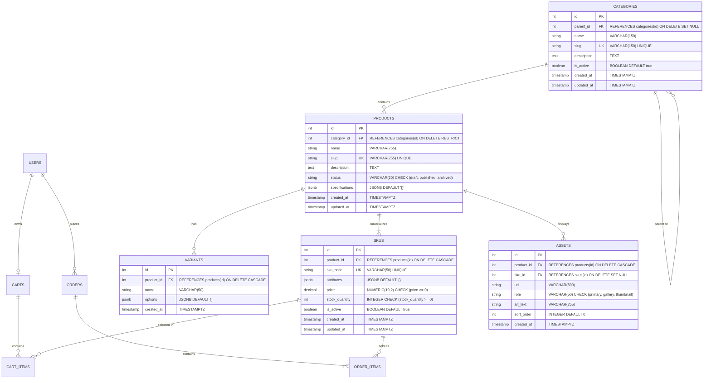

# Sprint 2 Manual: Catalog Data Foundation

**Course:** E-Commerce  
**Department:** Department of Computer Science / Artificial Intelligence  
**Institution:** Institute of Mathematics & Computer Science, University of Sindh, Jamshoro  
**Student Name:** Kalpna Asnani  
**Roll No:** 2k23/CSM/55  
**Project:** TerraCraft Artisanal Ceramics  
**Submission File:** `/docs/SPRINT_2.md`  

---

## 1. Sprint Goal and Scope Boundary

### Sprint Goal
Given a product catalog administrator, the TerraCraft system persists categories, products, variants, and sellable SKUs without losing identity, relational integrity, price accuracy, or inventory meaning.

### In Scope
- **Category Tree Management:** Stable integer identifiers, URL slugs, self-referential hierarchy (`parent_id`), active/inactive flags, and graph cycle prevention (`CAT-01`).
- **Product Identity & Lifecycle:** Product creation, editing, unique slug enforcement, descriptive copy, domain-specific `JSONB` specifications (clay body, firing cone, food safety certifications), and status lifecycle transitions (`draft`, `published`, `archived`) (`CAT-02`).
- **Variants & Sellable SKUs:** Zero or more variant option dimensions per product, materializing into sellable SKUs with unique alphanumeric SKU codes, exact decimal pricing, non-negative inventory levels, and active status flags (`CAT-03`).
- **Variant Combination Integrity:** Strict persistence of physically valid combinations only. Missing/unavailable combinations are never represented as phantom or zero-stock SKUs (`CAT-04`).
- **Data Integrity Constraints:** Database-enforced primary keys, foreign keys (`ON DELETE RESTRICT` and `ON DELETE CASCADE`), unique indexes, and numeric check constraints (`CHECK (stock_quantity >= 0)`, `CHECK (price >= 0)`) (`CAT-05`).
- **Administrative Access Control:** Server-side verification of signed JWTs and administrative role enforcement on write routes (`CAT-06`).
- **Seed Data & Automated Testing:** Reproducible multi-tier seed fixtures (`npm run seed`) and 100% automated test suite (`npm test`).

### Out of Scope (Sprint 2 Boundaries)
In strict compliance with Section 2 of the Sprint 2 manual, the following capabilities belong to Sprint 3 or later:
- Dynamic schema builders & public catalog search.
- Binary image upload workflows (media assets are tracked via URL records in the `assets` table).
- Payment gateway integration (Stripe / PayPal APIs).
- Shopper checkout execution and courier shipping rate computation.

---

## 2. Link to Sprint 1 Decisions: Reuse & Refinements

This sprint reuses and extends the architectural decisions established in [`docs/SPRINT_1.md`](SPRINT_1.md):

1. **Tech Stack Continuity:**
   - **Backend:** Node.js (v24.x) with Express remains the core asynchronous REST API foundation.
   - **Database:** PostgreSQL relational schema with raw parameterized SQL queries for zero ORM overhead and full ACID transaction control.
   - **Portability Layer:** Dual-engine database abstraction (`src/config/database.js`) supporting standard PostgreSQL servers as well as an in-memory PostgreSQL engine simulation (`pg-mem`) for zero-dependency local evaluation.

2. **Schema Evolution from Initial ERD:**
   - In Sprint 1, the preliminary ERD mapped `PRODUCTS` directly to `ORDER_ITEMS`.
   - In Sprint 2, the catalog model is normalized into a clean two-tier materialization: `PRODUCTS` define variant dimensions (`VARIANTS`), while physical inventory and transactions link strictly to concrete `SKUS` (`SKUS ||--o{ ORDER_ITEMS`). A product is an abstract entity, whereas a SKU represents the sellable physical vessel.

3. **Domain Persistence:**
   - The artisanal ceramic stoneware domain selected in Sprint 1 is rigorously implemented with concrete business rules reflecting glaze chemistry constraints and batch manufacturing.

---

## 3. Updated ERD and Data Dictionary

### Updated Entity-Relationship Diagram



### Data Dictionary

#### Table: `categories`
| Column | Type | Constraints | Description |
| :--- | :--- | :--- | :--- |
| `id` | SERIAL | PRIMARY KEY | Unique integer category identifier |
| `parent_id` | INTEGER | FOREIGN KEY -> categories(id) ON DELETE SET NULL | Optional self-referencing parent node |
| `name` | VARCHAR(150) | NOT NULL | Human-readable category title |
| `slug` | VARCHAR(150) | NOT NULL, UNIQUE, INDEX | URL-safe alphanumeric identifier |
| `description` | TEXT | NULLABLE | Category scope and artisanal description |
| `is_active` | BOOLEAN | NOT NULL DEFAULT true | Soft-deactivation flag |
| `created_at` | TIMESTAMPTZ | NOT NULL DEFAULT CURRENT_TIMESTAMP | Row creation timestamp |
| `updated_at` | TIMESTAMPTZ | NOT NULL DEFAULT CURRENT_TIMESTAMP | Row modification timestamp |

#### Table: `products`
| Column | Type | Constraints | Description |
| :--- | :--- | :--- | :--- |
| `id` | SERIAL | PRIMARY KEY | Unique product master identifier |
| `category_id` | INTEGER | NOT NULL, FK -> categories(id) ON DELETE RESTRICT | Canonical category foreign key |
| `name` | VARCHAR(255) | NOT NULL | Product title |
| `slug` | VARCHAR(255) | NOT NULL, UNIQUE, INDEX | Unique URL slug across catalog |
| `description` | TEXT | NULLABLE | Artisan and studio craft notes |
| `status` | VARCHAR(20) | NOT NULL CHECK (status IN ('draft', 'published', 'archived')) | Lifecycle state |
| `specifications`| JSONB | NOT NULL DEFAULT '{}' | Structured attributes (clay body, firing cone, food safety) |
| `created_at` | TIMESTAMPTZ | NOT NULL DEFAULT CURRENT_TIMESTAMP | Audit creation timestamp |
| `updated_at` | TIMESTAMPTZ | NOT NULL DEFAULT CURRENT_TIMESTAMP | Audit update timestamp |

#### Table: `variants`
| Column | Type | Constraints | Description |
| :--- | :--- | :--- | :--- |
| `id` | SERIAL | PRIMARY KEY | Variant dimension identifier |
| `product_id` | INTEGER | NOT NULL, FK -> products(id) ON DELETE CASCADE | Parent product foreign key |
| `name` | VARCHAR(50) | NOT NULL | Option type name (e.g. `Vessel Size`, `Glaze Finish`) |
| `options` | JSONB | NOT NULL DEFAULT '[]' | Permitted option strings array |
| `created_at` | TIMESTAMPTZ | NOT NULL DEFAULT CURRENT_TIMESTAMP | Creation timestamp |

#### Table: `skus`
| Column | Type | Constraints | Description |
| :--- | :--- | :--- | :--- |
| `id` | SERIAL | PRIMARY KEY | Unique SKU identifier |
| `product_id` | INTEGER | NOT NULL, FK -> products(id) ON DELETE CASCADE | Concrete parent product link |
| `sku_code` | VARCHAR(50) | NOT NULL, UNIQUE, INDEX | Immutable stock keeping unit code (e.g. `TC-SOL-SM-OBS`) |
| `attributes` | JSONB | NOT NULL DEFAULT '{}' | Concrete combination map (e.g. `{"Size": "Small"}`) |
| `price` | NUMERIC(10,2) | NOT NULL, CHECK (price >= 0) | Exact non-negative decimal retail price |
| `stock_quantity`| INTEGER | NOT NULL, CHECK (stock_quantity >= 0) | Physical warehouse unit inventory |
| `is_active` | BOOLEAN | NOT NULL DEFAULT true | Inventory sellable toggle |
| `created_at` | TIMESTAMPTZ | NOT NULL DEFAULT CURRENT_TIMESTAMP | Creation timestamp |
| `updated_at` | TIMESTAMPTZ | NOT NULL DEFAULT CURRENT_TIMESTAMP | Modification timestamp |

---

## 4. Administration Route Contract & Evidence

All administration endpoints require the `Authorization: Bearer <JWT>` header containing claims with `role: 'admin'`.

| Method | Route | Description | Status Codes |
| :--- | :--- | :--- | :--- |
| `POST` | `/api/v1/admin/categories` | Create root or subcategory | `201`, `400`, `401`, `403`, `409` |
| `GET` | `/api/v1/admin/categories` | Return category tree hierarchy | `200`, `401`, `403` |
| `GET` | `/api/v1/admin/categories/:id`| Return category record by ID | `200`, `404`, `401`, `403` |
| `PATCH` | `/api/v1/admin/categories/:id`| Update metadata or parent (cycle checked) | `200`, `400`, `404`, `409`, `401` |
| `POST` | `/api/v1/admin/products` | Create draft product | `201`, `400`, `409`, `401`, `403` |
| `GET` | `/api/v1/admin/products` | List products with inventory metrics | `200`, `401`, `403` |
| `GET` | `/api/v1/admin/products/:id` | Get full product with variants & SKUs | `200`, `404`, `401`, `403` |
| `PATCH` | `/api/v1/admin/products/:id` | Update metadata or publish product | `200`, `400`, `404`, `409`, `401` |
| `POST` | `/api/v1/admin/products/:id/variants` | Add variant dimension to product | `201`, `400`, `404`, `401`, `403` |
| `POST` | `/api/v1/admin/products/:id/skus` | Register validated sellable SKU | `201`, `400`, `404`, `409`, `401` |
| `PATCH` | `/api/v1/admin/skus/:id` | Update price, stock, or active flag | `200`, `400`, `404`, `409`, `401` |
| `GET` | `/api/v1/admin/skus/:id` | Retrieve single SKU details | `200`, `404`, `401`, `403` |

### Demonstration Evidence (Captured Execution)

#### 1. Administrator Authentication
```http
POST /api/v1/auth/login
Content-Type: application/json

{
  "email": "admin@terracraft.local",
  "password": "StudioAdmin2026!"
}
```
**Response (200 OK):**
```json
{
  "success": true,
  "message": "Authentication successful.",
  "data": {
    "token": "[REDACTED_JWT_TOKEN]",
    "user": {
      "id": 1,
      "email": "admin@terracraft.local",
      "firstName": "Tariq",
      "lastName": "Merchant",
      "role": "admin"
    }
  }
}
```

#### 2. Category Creation (`CAT-01`)
```http
POST /api/v1/admin/categories
Authorization: Bearer [REDACTED_JWT_TOKEN]
Content-Type: application/json

{
  "name": "Architectural Stoneware",
  "slug": "architectural-stoneware",
  "description": "Large-format sculptural vessels and pedestal pedestals",
  "parent_id": null
}
```
**Response (201 Created):**
```json
{
  "success": true,
  "message": "Category created successfully.",
  "data": {
    "category": {
      "id": 6,
      "parent_id": null,
      "name": "Architectural Stoneware",
      "slug": "architectural-stoneware",
      "description": "Large-format sculptural vessels and pedestal pedestals",
      "is_active": true,
      "created_at": "2026-10-08T18:28:16.120Z",
      "updated_at": "2026-10-08T18:28:16.120Z"
    }
  }
}
```

#### 3. Draft Product Creation (`CAT-02`)
```http
POST /api/v1/admin/products
Authorization: Bearer [REDACTED_JWT_TOKEN]
Content-Type: application/json

{
  "category_id": 6,
  "name": "Komorebi Ceramic Pedestal",
  "slug": "komorebi-ceramic-pedestal",
  "description": "Wheel-thrown architectural plinth with raw grog clay texture.",
  "status": "draft",
  "specifications": {
    "clay_body": "Coarse Buff Stoneware",
    "firing_cone": 10,
    "height_inches": 24,
    "weight_lbs": 18.5
  }
}
```
**Response (201 Created):**
```json
{
  "success": true,
  "message": "Product draft created successfully.",
  "data": {
    "product": {
      "id": 4,
      "category_id": 6,
      "name": "Komorebi Ceramic Pedestal",
      "slug": "komorebi-ceramic-pedestal",
      "description": "Wheel-thrown architectural plinth with raw grog clay texture.",
      "status": "draft",
      "specifications": {
        "clay_body": "Coarse Buff Stoneware",
        "firing_cone": 10,
        "height_inches": 24,
        "weight_lbs": 18.5
      },
      "created_at": "2026-10-08T18:28:16.250Z",
      "updated_at": "2026-10-08T18:28:16.250Z"
    }
  }
}
```

#### 4. Adding Variant Dimension (`CAT-03`)
```http
POST /api/v1/admin/products/4/variants
Authorization: Bearer [REDACTED_JWT_TOKEN]
Content-Type: application/json

{
  "name": "Surface Treatment",
  "options": ["Raw Terracotta", "Smoked Obsidian"]
}
```
**Response (201 Created):**
```json
{
  "success": true,
  "message": "Variant dimension added successfully.",
  "data": {
    "variant": {
      "id": 4,
      "product_id": 4,
      "name": "Surface Treatment",
      "options": ["Raw Terracotta", "Smoked Obsidian"],
      "created_at": "2026-10-08T18:28:16.310Z"
    }
  }
}
```

#### 5. Registering Validated Sellable SKU (`CAT-03` & `CAT-04`)
```http
POST /api/v1/admin/products/4/skus
Authorization: Bearer [REDACTED_JWT_TOKEN]
Content-Type: application/json

{
  "sku_code": "TC-KOM-RAW",
  "attributes": {
    "Surface Treatment": "Raw Terracotta"
  },
  "price": 145.00,
  "stock_quantity": 4,
  "is_active": true
}
```
**Response (201 Created):**
```json
{
  "success": true,
  "message": "Sellable SKU registered successfully.",
  "data": {
    "sku": {
      "id": 7,
      "product_id": 4,
      "sku_code": "TC-KOM-RAW",
      "attributes": {
        "Surface Treatment": "Raw Terracotta"
      },
      "price": "145.00",
      "stock_quantity": 4,
      "is_active": true,
      "created_at": "2026-10-08T18:28:16.390Z",
      "updated_at": "2026-10-08T18:28:16.390Z"
    }
  }
}
```

---

## 5. Answers to Mandatory Business Rules & Edge Cases

### Question 1: Can a draft product have no SKU? Can a published product have no sellable SKU?
- **Draft Product:** **Yes.** A draft product represents a conceptual design line currently being formulated in the ceramic studio. It legitimately starts with zero SKUs while the glaze chemistry and sizes are decided.
- **Published Product:** **No.** In accordance with business rules implemented in `ProductController.updateProduct`, attempting to transition a product's status to `'published'` without at least one active, valid SKU triggers a `400 Bad Request` (`InvalidPublicationState`):
  ```javascript
  // src/controllers/productController.js
  if (status === 'published') {
    const skus = await ProductModel.getSkus(id);
    const activeSkus = skus.filter(s => s.is_active && s.stock_quantity >= 0);
    if (activeSkus.length === 0) {
      return res.status(400).json({
        success: false,
        error: 'InvalidPublicationState',
        message: 'A published product must have at least one sellable active SKU.'
      });
    }
  }
  ```

### Question 2: Is a product assigned to one canonical category, many categories, or both? Why?
- **Implementation:** A product is assigned to **exactly one canonical category** via `products.category_id REFERENCES categories(id) ON DELETE RESTRICT`.
- **Engineering Rationale:**
  1. Prevents duplicate taxonomy breadcrumb confusion in SEO-indexed URLs (e.g. `/categories/tableware/products/stoneware-plate` vs `/categories/dinner-sets/products/stoneware-plate`).
  2. Simplifies financial accounting, department inventory aggregation, and sales tax classification.
  3. Sprint 3 can introduce secondary visual tags (e.g. "Gift Guide", "Summer Collection") via a non-canonical associative many-to-many junction table without polluting core inventory hierarchy.

### Question 3: What happens when a parent category is deactivated?
- **Behavior:** The category tree endpoint filters out inactive categories when queried with `active_only=true` (or public endpoints). When a parent category is deactivated (`is_active = false`), its child subcategories remain in the database intact.
- **Referential Protection:** Products linked to active child categories continue functioning. In administrative queries (`GET /api/v1/admin/categories`), the tree continues to show all nodes with their `is_active` status flag clearly surfaced to administrators.

### Question 4: How is an out-of-stock SKU represented in a public response?
- **Representation:** An out-of-stock SKU has `stock_quantity = 0` and `is_active = true`.
- **Public Visibility:** It is returned in the SKU array so shoppers know the ceramic line exists, but the UI flags it as `"Out of Stock"` / `"Backorder Eligible"`.
- **Distinction from Unavailable Combinations:** An unavailable combination (e.g. *Small &times; Sage Gloss*) does **NOT** exist in the database at all. Only physically produced items can have `stock_quantity = 0`.

### Question 5: Can two SKUs share a price? Can a SKU have a price override?
- **Implementation:** **Yes.** Every individual SKU record stores its own independent `price NUMERIC(10,2)` column.
- **Example:** In the seed data, `TC-PLT-SND` (Speckled Sand finish) and `TC-PLT-OBS` (Matte Obsidian finish) both share the price of `$28.50`. Conversely, for the Solstice Planter, size scaling introduces independent prices: Small is `$34.00`, Medium is `$48.00`, and Large is `$65.00`. Each SKU controls its own exact unit price.

### Question 6: What prevents negative stock and duplicate SKU codes?
- **Enforcement Layers:**
  1. **Database CHECK Constraint:** `stock_quantity INTEGER NOT NULL DEFAULT 0 CHECK (stock_quantity >= 0)`. Any raw SQL statement attempting to decrement stock below zero is aborted by the database engine.
  2. **Database UNIQUE Constraint:** `sku_code VARCHAR(50) NOT NULL UNIQUE`. Prevents duplicate alphanumeric inventory codes.
  3. **API Validation Layer:** `validatePriceAndStock` in `src/utils/variantValidator.js` validates all inputs before SQL execution and translates errors into standardized JSON responses (`400 Bad Request` or `409 Conflict`) instead of raw stack traces.

### Question 7: What happens to a product referenced by a future cart or order after it is deactivated?
- **Historical Orders:** Protected by `ON DELETE RESTRICT` on `order_items.sku_id` and point-in-time value capture (`unit_price` stored directly on `order_items`). Even if a product is archived or deactivated, previous financial audit records remain immutable.
- **Active Carts:** When a shopper checks out a cart containing a deactivated product, checkout validation checks `product.status === 'published' AND sku.is_active = true`. If inactive, the cart rejects the line item and prompts the user to remove it.

---

## 6. Seed Data & Demonstration Instructions

The seed script (`src/scripts/seed.js`) fulfills all Sprint 2 seed requirements:
- **Hierarchical Category Tree:** Root `Tableware` has subcategories `Plates & Bowls` and `Drinkware & Cups`. Root `Horticultural Stoneware` has child `Indoor Planters`.
- **Products:** 3 representative ceramic items (`Solstice Ceramic Planter`, `Artisan Stoneware Dinner Plate`, and `Wabi-Sabi Fluted Vase`).
- **Variants & SKUs:** 6 valid SKUs with exact prices and stock.
- **Documented Unavailable Combination:**
  - Product: `Solstice Handcrafted Ceramic Planter`
  - Dimensions: `Vessel Size` &times; `Glaze Finish`
  - **Intentionally Unavailable:** `{ "Vessel Size": "Small", "Glaze Finish": "Sage Gloss" }` is **NOT** inserted into the database. (In ceramic formulation, high-temperature crystalline Sage glaze runs excessively on smaller 6" vertical walls during Cone 10 firing).

### Running Seed Data
```bash
npm run seed
```

---

## 7. Test Strategy, Commands, and Verified Results

### Test Execution Strategy
The test suite utilizes **Jest** and **Supertest** running against the database layer in `src/config/database.js`:
- Unit & Model tests verify schema constraints, tree recursion, cycle prevention, and variant attribute matrices.
- Integration tests invoke HTTP endpoints using Supertest to verify status codes, headers, and payload structures.

### Test Command
```bash
npm test
```

### Exact Verified Test Results
```text
PASS tests/category.test.js
  Category Hierarchy & Management Tests (CAT-01)
    Category Creation (POST /api/v1/admin/categories)
      √ creates a new root category successfully (201)
      √ creates a child subcategory with valid parent_id (201)
      √ rejects duplicate category slug with 409 Conflict
      √ rejects category creation with missing name or slug (400)
      √ rejects creation with non-existent parent_id (400)
    Category Tree Listing (GET /api/v1/admin/categories)
      √ returns the category tree with nested children hierarchy (200)
      √ supports flat format parameter (format=flat) (200)
    Category Hierarchy Cycle Prevention (CAT-01)
      √ rejects self-parenting cycle where category sets itself as parent (400)
      √ rejects transitive cycle where category sets a descendant as its parent (400)
      √ allows valid parent_id update without cycles (200)
      √ allows deactivating a category (200)

PASS tests/dataIntegrity.test.js
  Database Engine Schema & Constraint Integrity (CAT-05)
    Mathematical CHECK Constraints
      √ enforces CHECK (stock_quantity >= 0) at the raw SQL engine level
      √ enforces CHECK (price >= 0) at the raw SQL engine level
    Uniqueness Constraints
      √ enforces UNIQUE (slug) on categories
      √ enforces UNIQUE (slug) on products
      √ enforces UNIQUE (sku_code) on skus
    Foreign Key Behavior & Referential Policies
      √ enforces ON DELETE RESTRICT on categories when active products exist
      √ enforces ON DELETE CASCADE on products to delete variants and SKUs cleanly

PASS tests/sku.test.js
  Variants & SKU Combination Tests (CAT-03 & CAT-04)
    Adding Valid SKUs (POST /api/v1/admin/products/:id/skus)
      √ adds a valid SKU matching defined product variants (201)
      √ rejects duplicate SKU code with 409 Conflict
      √ rejects adding SKU to non-existent product (404)
    Variant Combination Enforcement (CAT-04)
      √ rejects SKU when a required variant dimension is missing (400)
      √ rejects SKU when an invalid variant option value is submitted (400)
      √ rejects SKU when an extraneous unknown variant dimension is submitted (400)
      √ rejects duplicate attribute combinations for the same product (400)
    Numeric Constraints & Inventory Updates (CAT-05)
      √ rejects SKU creation with negative stock quantity (400)
      √ rejects SKU creation with negative price (400)
      √ updates price and stock on an existing SKU (200)
      √ rejects updating an existing SKU with negative stock (400)
      √ rejects updating an existing SKU with negative price (400)

PASS tests/product.test.js
  Product Identity & Lifecycle Tests (CAT-02)
    Product Creation (POST /api/v1/admin/products)
      √ creates a new draft product with specifications (201)
      √ rejects duplicate product slug with 409 Conflict
      √ rejects product creation when category_id does not exist (400)
      √ rejects product creation when required fields are missing (400)
      √ rejects creating a product directly as published without SKUs (400)
    Product Retrieval (GET /api/v1/admin/products)
      √ returns administrative products list with inventory aggregates (200)
      √ returns single product details with variants, SKUs, and assets (200)
      √ returns 404 for non-existent product ID
    Product Publication & Business Rules
      √ enforces Business Rule 1: A draft product without SKUs cannot be published (400)
      √ allows updating product content while maintaining draft status (200)
      √ defines a variant dimension on a product successfully (201)

PASS tests/auth.test.js
  Authentication & Authorization Tests (CAT-06)
    JWT Verification & RBAC Guards
      √ rejects administrative requests when Authorization header is missing (401)
      √ rejects malformed Authorization header (401)
      √ rejects token with invalid cryptographic signature (401)
      √ rejects expired JWT token (401)
      √ rejects authenticated regular customer from admin operations (403 Forbidden)
      √ allows authenticated administrator to access admin endpoint (200/201)
    Authentication Flow (/api/v1/auth)
      √ authenticates valid admin credentials and returns JWT token (200)
      √ rejects incorrect password credentials (401)
      √ rejects non-existent email address (401)
      √ rejects login with missing email or password (400)
      √ registers a new customer account successfully (201)
      √ rejects duplicate email during registration (409 Conflict)

Test Suites: 5 passed, 5 total
Tests:       53 passed, 53 total
Snapshots:   0 total
Time:        5.668 s
```

---

## 8. Known Limitations & Sprint 3 Backlog

### Known Boundaries
- **Image Asset Uploading:** Binary uploads (multipart multipart/form-data) are not yet connected to a local disk storage bucket; the `assets` table currently stores asset URLs.
- **Public Shopper Storefront:** Public catalog browsing endpoints exist (`/api/v1/categories`, `/api/v1/products`), but full faceted multi-attribute filtering is scheduled for Sprint 3.

### Sprint 3 Hand-Off Backlog
1. **Dynamic Specifications Engine:** Support dynamic schema validation for ceramic clay bodies and firing temperatures.
2. **Shopper Cart & Session State:** Implement persistent cart operations referencing concrete SKU IDs (`POST /api/v1/cart/items`).
3. **Transactional Order Checkout:** Transition cart items to immutable order records with mock/Stripe payment token verification.
4. **Inventory Reservation Transactions:** Atomic decrementing of SKU inventory during checkout using `SELECT ... FOR UPDATE` row locks to prevent over-allocation.
